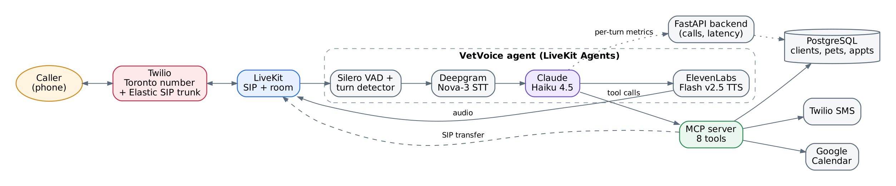

# VetVoice AI

An AI receptionist that answers a vet clinic's phone, books, moves and cancels appointments, texts a confirmation, and hands urgent calls to a person.

<em>A call goes from Twilio into LiveKit, through speech-to-text, Claude and text-to-speech, and Claude uses tools to work the calendar.</em>

## Results

| Metric | Result |
|---|---|
| Test calls | 100+ simulated calls |
| Voice-to-voice latency | under 800 ms (median) |
| Routine test requests fully resolved | 80%+ |

A call only counts as resolved if the database and calendar actually changed and an SMS went out, not because the transcript sounded right.

## How it works

- A caller dials a Toronto number. Twilio passes the call to LiveKit, which starts the agent.
- The agent listens with Deepgram, decides what to do with Claude Haiku 4.5, and speaks with ElevenLabs. Everything streams so replies start fast.
- Claude can't touch the database itself. It calls 8 small tools on an MCP server (check times, book, reschedule, cancel, find client or pet, send SMS, transfer).
- Emergencies, prescriptions and billing fights always go to a human.
- A second "caller bot" agent plays 100 scripted callers, and a script checks the real calendar afterward to grade each call.

## How to run it

1. Copy `.env.example` to `.env` and add your LiveKit, Anthropic, Deepgram, ElevenLabs and Twilio keys.
2. `docker compose up --build` starts Postgres (with 200 fake clients), the API, the MCP server and the agent.
3. Hook up the phone number with [docs/telephony.md](docs/telephony.md), then call it.
4. Run the test calls: `docker compose --profile test up -d caller-bot`, then `uv run python -m caller_bot.run_scenarios --reset`.
5. Get the numbers: `uv run python eval_report.py runs/<run>.jsonl` and `uv run python latency_report.py`.

Tests that don't need any API keys: `uv run pytest`.

## What I learned

- Latency is a budget. Waiting to be sure the caller stopped talking, the model's first word and the first audio all add up, so I log each part on every turn instead of guessing.
- Giving the model tools with clear error messages ("10:00 is taken, closest open times are 9:30 and 10:30") works better than prompt rules alone. The database blocks double booking even if the model gets it wrong.
- A call only counts as solved if the calendar actually changed. A friendly transcript saying "you're booked" proves nothing.
